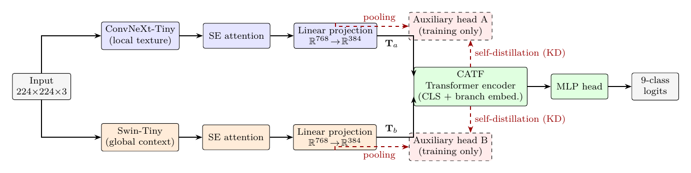

# WF-Net: a heterogeneous dual-branch network for waste image classification

[](LICENSE)


Official code, data splits, seeds and per-image predictions of the paper

> **WF-Net: A heterogeneous dual-branch deep network with cross-branch attention token fusion for waste image classification**<br>
> Mehmet Burukanli, Davut Ari and Songul Karakus<br>
> Department of Computer Engineering, Bitlis Eren University, Turkey.<br>
> *Under review at The Journal of Supercomputing (Springer Nature).*

**Code version 1.0** (November 2026) is the code that produced the results reported in the paper.

## Overview

Automated waste sorting has to classify a continuous image stream in real time and to separate classes
that differ in material and texture rather than in shape, often with few labels. WF-Net combines a local
texture model and a global context model: it fuses the token sequences of an ImageNet-pretrained
ConvNeXt-Tiny and a Swin-Tiny through one standard Transformer encoder layer.

The study also asks which parts of such a design matter. Every comparison is repeated under one protocol,
tested on paired per-image predictions and on training runs, and repeated on an unseen dataset, on a
20-times larger dataset and for inference cost. The paper reports what the components do not bring as
openly as what they bring, and this repository lets you recompute those numbers yourself.

## The model

<p align="center">
  
</p>

- **Branches.** ConvNeXt-Tiny for local texture and Swin-Tiny for global context, both pretrained on ImageNet. Each final feature map is re-scaled by squeeze-and-excitation attention and projected to 49 tokens of dimension 384.
- **Fusion.** CATF, the label used in the paper for cross-branch attention token fusion, is a standard pre-norm Transformer encoder layer with six heads over the joint token sequence, with learnable branch embeddings and a CLS token. It is not a new attention operator: every ConvNeXt token can attend to the Swin tokens and vice versa because they share one layer.
- **Deep self-distillation.** During training, an auxiliary head on each branch is supervised directly and distilled toward the softened fused output. The teacher logits are detached, so the distillation is one-directional. The heads are discarded at inference.
- **Size.** 57.4M parameters and 18.2 GFLOPs per 224x224 image.

## Main results

On the nine-class, 770-image WasteSnap dataset, 5-fold stratified cross-validation, mean and standard deviation over the folds, in %:

| Model | Accuracy | Macro-F1 | Parameters (M) | GFLOPs |
|---|---|---|---:|---:|
| **WF-Net** | **89.35 ± 2.41** | **88.49 ± 3.09** | 57.4 | 18.18 |
| ViT-B/16 | 87.53 ± 1.41 | 86.35 ± 2.08 | 85.8 | 33.70 |
| Swin-T | 85.84 ± 4.14 | 84.83 ± 4.58 | 27.5 | 8.98 |
| WF-Net-Lite | 82.73 ± 4.87 | 81.53 ± 5.37 | 11.6 | 3.58 |
| VGG16 | 82.60 ± 4.93 | 81.14 ± 5.91 | 134.3 | 30.93 |

What the evaluation shows:

- **Against the baselines.** WF-Net ranks first of eleven models. Paired per-image tests are significant against nine of the ten baselines, but not against ViT-B/16 (+2.08 points, 95% CI [+0.04, +4.13], McNemar p = 0.076). Over 3x5 repeated cross-validation its macro-F1 is 88.84%.
- **Inside the model.** In-domain, CATF does not outperform plain concatenation (-0.22 points, [-1.86, +1.42]), and neither SE attention nor self-distillation has a significant effect.
- **Under distribution shift.** Without fine-tuning on the 8,213 mapped images of Garbage12, WF-Net is the best of the eleven models with 47.34% macro-F1, and its fold ensemble beats concatenation by 1.35 points ([+0.65, +2.07], McNemar p = 0.003). Twenty labelled target images per class and a re-fitted classifier raise the macro-F1 to 73.88%.
- **On more data.** With 15,515 images, the advantage does not persist: ViT-B/16 reaches 98.39%, concatenation 98.13% and WF-Net 96.79%. Turning off MixUp and CutMix or easing the regularization does not recover this, and neither does a budget of 40 epochs.
- **Learned branch weighting.** The per-image weighting of the branches is content-dependent, but only weakly related to which branch is more accurate on an image (rank correlations of 0.08 and -0.03).
- **Lightweight pair.** WF-Net-Lite, built from EfficientNet-B0 and DeiT-Tiny, needs 3.6 GFLOPs but loses 6.91 points. In a pilot at the budget of the protocol, distillation from WF-Net gains 0.95 points, which is not significant.
- **Cost.** One RTX A4000 processes 532 images/s with mixed precision. The 173 training jobs of the evaluation take about 40 GPU-hours, are embarrassingly parallel, and are projected to finish in about 2.5 hours on 16 GPUs.

## Check the numbers of the paper

No training, no GPU and no images are needed:

```
pip install numpy scipy
python verify_statistics.py
```

The script recomputes from `predictions/` the mean and standard deviation of every metric cell of Tables 3, 6, 7 and 8, the pairwise comparisons of Table 5 (pooled macro-F1 difference, paired-bootstrap 95% confidence interval, exact McNemar test, corrected resampled t-tests, Holm correction), the paired comparisons of Sections 4.5, 4.7 and 4.8, and the distillation pilot of Section 5. Each of its 593 checks prints `MATCH` or `MISMATCH` against the value printed in the paper, which is listed in `expected_values.json`. It takes about a minute and uses the same bootstrap seeds as the original analysis.

## What is in this repository

| Path | Content |
|---|---|
| `verify_statistics.py`, `expected_values.json` | Recomputation of the paper's statistics from the predictions |
| `predictions/` | Per-image predictions and per-fold metrics of the runs reported in the paper |
| `splits/` | Train, validation and test role of every image in every fold, for each split seed |
| `seeds/job_seeds.csv` | The deterministic seed of every (model, fold) training job |
| `measurements/` | FLOP counts, latency, throughput and scaling measurements of Section 4.10, and the sensitivity study |
| `config.py`, `src/` | Models, training, evaluation and analysis code |
| `run_experiments.py` | Runs the main protocol step by step |
| `followup_a4000.py` | Additional runs of Sections 4.8 and 5 |

Images and trained weights are not included.

### Predictions

Every file `predictions/<run>/<model or arm>/fold<k>.npz` holds `y_true`, `y_pred` and `y_prob`, and the image order through `test_idx` and `test_paths` (`class/filename`) where it applies. The file `fold<k>.json` next to it holds the metrics of the fold.

| Run | Content |
|---|---|
| `wastesnap_seed42` | Main 5-fold run: ten baselines, seven ablation variants and WF-Net |
| `wastesnap_seed1337`, `wastesnap_seed2024` | Further repetitions of WF-Net, ViT-B/16, Swin-T, VGG16 and the variant without self-distillation for the 3x5 repeated cross-validation |
| `garbage12_zero_shot_seed42` | Zero-shot transfer of the fold models of Table 7 to the 8,213 mapped Garbage12 images; row `i` is the `i`-th mapped image of `splits/garbage12_seed42.csv` |
| `garbage12_seed42` | Training on the complete Garbage12 dataset, 3 folds, 4 models |
| `followup_garbage12_a4000` | WF-Net on Garbage12: `default` (control run of fold 0, identical to the default run), `nomix`, `eased`, `nosd`, `default40` |
| `followup_lite_a4000` | WF-Net-Lite distilled from WF-Net, 40 epochs (`kd`); its control is `Ablation__WF_Net_Lite` of the main run |

### Splits and seeds

`splits/<dataset>_seed<s>.csv` lists every image with its index, relative path, class and one column per fold, whose value is `train`, `val` or `test`. Folds come from stratified k-fold splitting with the split seed; 15% of the remainder is the validation set. Images are read in case-insensitive name order on every file system, which is the order of the reported runs on NTFS, so `make_folds` reproduces the shared splits on any operating system.

Each (model, fold) job uses the deterministic seed `1000*s + 97*f + crc32(model name) % 89`, listed in `seeds/job_seeds.csv`, so results do not depend on the order in which jobs run. ResNet50 and DenseNet121 happen to get the same values. A control run of one complete Garbage12 fold reproduced the predictions of the default run image by image on the same GPU and software.

## Running the experiments

Python 3.11 and the packages of `requirements.txt`, in a virtual environment at `.venv` in the repository root (`run_experiments.py` checks this; `--force` skips the check). Place the two public datasets under `data/`:

- `data/WasteSnap_Dataset`: [Multi-Class Waste Image Classification Dataset](https://www.kaggle.com/datasets/mayankbansal2205/multi-class-waste-image-classification-dataset), nine class folders, 770 images.
- `data/garbage_classification`: [Garbage Classification](https://www.kaggle.com/datasets/mostafaabla/garbage-classification), twelve class folders, 15,515 images. The paper calls this dataset Garbage12.

```
python run_experiments.py            # the complete protocol; finished jobs are skipped on a restart
python run_experiments.py --status   # progress
python run_experiments.py --quick    # short smoke test
python followup_a4000.py             # after the main run
```

Outputs go to `results/`. `run_experiments.py` runs 198 training jobs, also some that the paper does not report: one further fusion variant and two more repetitions of two ablation variants. `src/posthoc.py` writes a first summary while the experiments run; the statistics of the paper are those of `verify_statistics.py`.

## Citation

The paper is currently **under review at The Journal of Supercomputing**. The full reference will be added here after publication. Until then, please cite it as:

> M. Burukanli, D. Ari and S. Karakus, "WF-Net: A heterogeneous dual-branch deep network with cross-branch attention token fusion for waste image classification," under review at The Journal of Supercomputing, 2026.

```bibtex
@unpublished{burukanli2026wfnet,
  author = {Burukanli, Mehmet and Ari, Davut and Karakus, Songul},
  title  = {{WF-Net}: A heterogeneous dual-branch deep network with cross-branch attention token fusion for waste image classification},
  note   = {Under review at The Journal of Supercomputing},
  year   = {2026}
}
```

GitHub also shows this reference through `CITATION.cff`.

## License

The code is released under the MIT License, see `LICENSE`. The datasets are not part of this repository and keep their own licenses.
